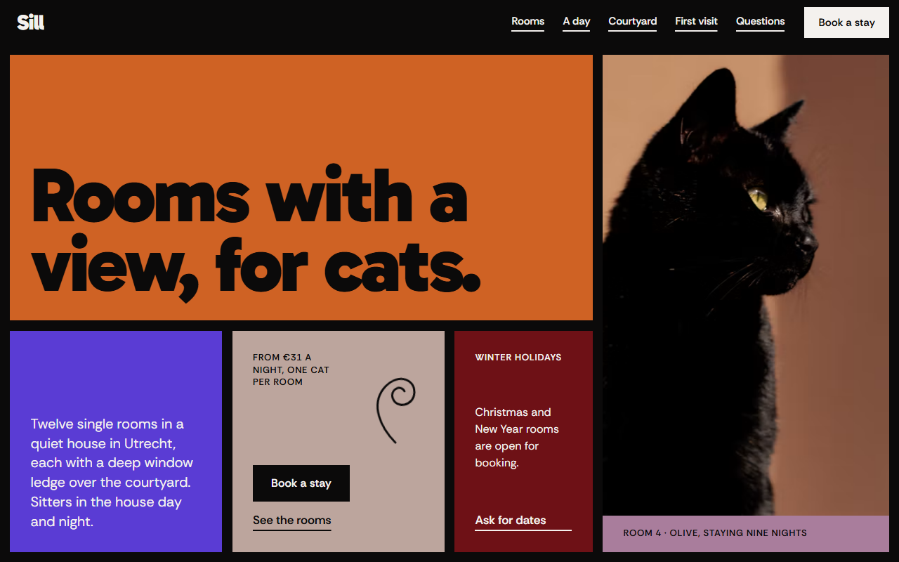
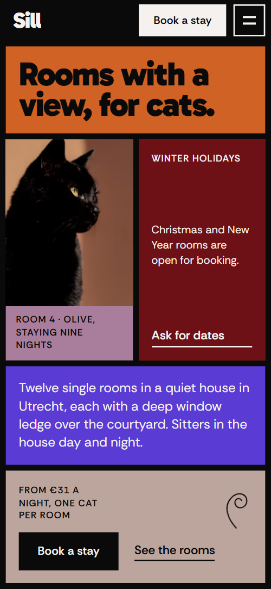
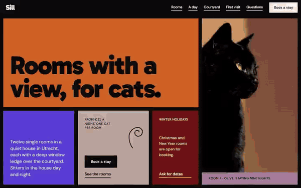

# Free HTML pet boarding website template with GSAP scroll animations

Pet boarding website template: a one-page site for a small cattery or pet hotel, with three room types and nightly prices, a timed daily routine, four sitters, house rules and a booking form. The look is flat colour panels on a black page. It is one HTML file with an AGENTS.md, so an AI agent can adapt it to your own boarding house.

[](LICENSE)  

**[Live demo](https://8bsite.github.io/pet-boarding-website-template/)** · **[Use this template](https://github.com/new?template_name=pet-boarding-website-template&template_owner=8bsite)** · **[Download ZIP](https://github.com/8bsite/pet-boarding-website-template/archive/refs/heads/main.zip)** · **[Template page on 8b.com](https://8b.com/templates/sill/)**

<a href="https://8bsite.github.io/pet-boarding-website-template/"></a> <a href="https://8bsite.github.io/pet-boarding-website-template/"></a>

<p align="center"><a href="https://8bsite.github.io/pet-boarding-website-template/"></a><br><sub>Scroll animation</sub></p>

## Use it with Claude Code, Cursor or Codex

Download the four files into your project folder (`curl.exe` in Windows PowerShell):

```bash
curl -LO https://raw.githubusercontent.com/8bsite/pet-boarding-website-template/main/index.html
curl -LO https://raw.githubusercontent.com/8bsite/pet-boarding-website-template/main/AGENTS.md
curl -LO https://raw.githubusercontent.com/8bsite/pet-boarding-website-template/main/LICENSE
curl -LO https://raw.githubusercontent.com/8bsite/pet-boarding-website-template/main/CREDITS.md
```

Then fill in the angle brackets and give your agent this prompt:

```text
Read AGENTS.md, then edit index.html. Turn this template into the site for <my boarding business: the animals I take, my town and address, the room types with nightly prices, the daily routine with times, the team and their duties, vaccination rules, minimum stay, drop off and pick up hours, how guests book>. Replace first the brand name, the town, the three room types and prices, and the sitters. Keep exactly twelve windows in the opening facade and four house rules, plus the section ids and the classes AGENTS.md lists. Ask me for any missing fact and never invent prices, hours, addresses, vet clinics, licences, reviews or contacts.
```

Start with the facts only the owner has: town, address, phone, the three nightly prices, vaccination rules, minimum stay, drop-off hours and the real team. In a vibe coding session with Claude Code, Cursor or Codex, tell the agent to ask for these and never to invent a vet clinic, a price or a sitter. Next it searches for the old name in any letter case and replaces every match, then sets the footer wordmark's --len value to the new name's character count. Leave alone the section ids, the classes AGENTS.md lists, the twelve facade windows and the four house rules: the grid and the scenes are built for those counts.

No agent? Click **[Use this template](https://github.com/new?template_name=pet-boarding-website-template&template_owner=8bsite)**, edit `index.html` on GitHub and turn on **Settings > Pages**.

## Sections and motion

- **Navigation**: black top bar: wordmark, five section links, Book a stay button; hides on scroll down; phone menu overlay of colour panels.
- **Rooms with a view, for cats.**: two screens: a grid of colour panels with headline, photo, intro, price and buttons, then a facade of twelve coloured windows (demo: twelve rooms, five with cats). Smooth scrolling throughout. Scrolling on, a black hill swallows the first screen as its panels drift apart, then the facade's twelve windows fill in.
- **Three shapes of room**: room types as panels of different shapes, each with photo, text and price per night, plus an "every room has" list (demo: Ledge, Tower, Burrow). Several headings rise line by line. Tied to scroll, each room panel opens out from a square in its corner.
- **A letter every evening**: three short notes in a handwriting font with photos (demo: the evening letters sitters send to owners); works as testimonials. Here, in the team and on the first visit, photos peek up inside their frames as you scroll and hand-drawn curls draw themselves.
- **A day at Sill**: pinned horizontal track of six timed panels under a sky band (demo: the cats' daily schedule from 07:00 to 21:00). Pinned, the six timed panels slide sideways under a sky band that shifts through six colours as a black sun rises and sets.
- **Four people, always in the house**: team of four: portraits behind coloured ledges at stepped heights, name and role on each ledge.
- **Every window faces the courtyard**: one photo cut into six window panes by black mullions, with heading, text, a three-item list and a second photo with caption (demo: the courtyard view). Tied to scroll, the six panes of the window photo slide from scattered offsets into one picture as their tints fade.
- **Your first visit**: four numbered steps as a rising staircase of panels, a photo on the top step (demo: what happens on a first visit).
- **A quiet house, by rule**: four rules or promises as panels with one big word each (demo: No dogs, One cat, Own air, Vet close). Four rule panels start tilted, scattered and orange, then settle into a row in their own colours as each big word slims.
- **Questions owners ask**: questions and answers (native &lt;details&gt;) beside a heading panel with a phone link.
- **Book a room**: booking form framed by four contact panels: Call, Visit, Hours, Write (phone, address, opening hours, email are placeholders). Tied to scroll, the Call, Visit, Hours and Write panels slide in from four sides to frame the booking form.
- **Footer**: black footer: links, address, phone, email, a one-line note, copyright with the Design: 8B credit, and a large wordmark.

## Design

 black page and gutters  
 off-white text  
 orange panels, sky, wordmark  
 maroon panels  
 violet panels  
 taupe panels and form  
 mauve panels  
 rust panel behind the rooms heading and the Brushing hour  
 sage panels  
 mustard panels, button hover

**Gabarito**: heavy, tight grotesk headings, set very large. **Rethink Sans**: body text, buttons, uppercase labels. **Playwrite US Modern**: handwriting for the sitters' letters (Google Fonts). Flat, square panels of saturated colour sit on a 12-column grid, the black page showing through as thick gutters, and photos fill their panels edge to edge. Room panels differ in shape, first-visit steps rise like a staircase and black mullions cut the courtyard photo into six panes.

## Questions

**Does the booking form send requests?**  
No. The form asks for name, email, the cat's name, dates, a room and notes, checks that name and email are filled in, then shows a thank-you line and sends nothing. Connect Formspree or Netlify Forms, or remove the form and keep the email link. AGENTS.md has the steps. Also edit the line that promises an answer within one working day.

**Can I use it as a pet sitting website template?**  
Yes. As a pet sitting template it needs three changes: rename the room types as the packages you sell, turn the evening letters into the updates you send owners, and swap the four sitter portraits for your own people. Then edit the six timed slots of the day and add your town, phone and prices.

**Can it be a dog boarding website template?**  
Yes, with edits. The layout does not depend on the animal, but the copy does: replace the cat photos, the lines that talk about cats and the four house rules, whose first panel reads No dogs. Rooms, prices and the six timed slots of the day can then describe your kennel. Expect more rewriting than for a cattery.

## Is it the right base?

Choose this template when guests sleep over and the pitch is the place itself: a cattery, a pet hotel or, with new photos and rules, a small kennel. As a pet care website template it suits animals that stay, not services that come to the door. A groomer or dog walker has no rooms or overnight routine for the rooms and day sections to describe. For a clinic with appointments, the template for an [animal hospital](https://8b.com/templates/burrow/) fits better. The weak spot is booking: the form has fields for dates and a room but sends nothing until you connect a form service, and there is no availability calendar or online payment.

## Before you publish

- Replace what is marked `data-8b-placeholder` (social preview image, favicon, phone, form, email) and the invented demo facts; [AGENTS.md](AGENTS.md) lists them.
- The form sends nothing yet: connect it to Formspree or Netlify Forms, or remove it.

## Tech

GSAP 3.13.0, ScrollTrigger, SplitText, Lenis 1.3.27 from jsDelivr, 94 KB, no build step. Chrome and Edge 108+, Safari 15.4+, Firefox 101+ (it uses cascade layers, small/dynamic viewport units). With "reduce motion" on, the page is complete and still.

## License

MIT, see [LICENSE](LICENSE). Photos, fonts and libraries keep their own licences: [CREDITS.md](CREDITS.md). More free templates: [8b.com/templates](https://8b.com/templates/) · [github.com/8bsite](https://github.com/8bsite).
